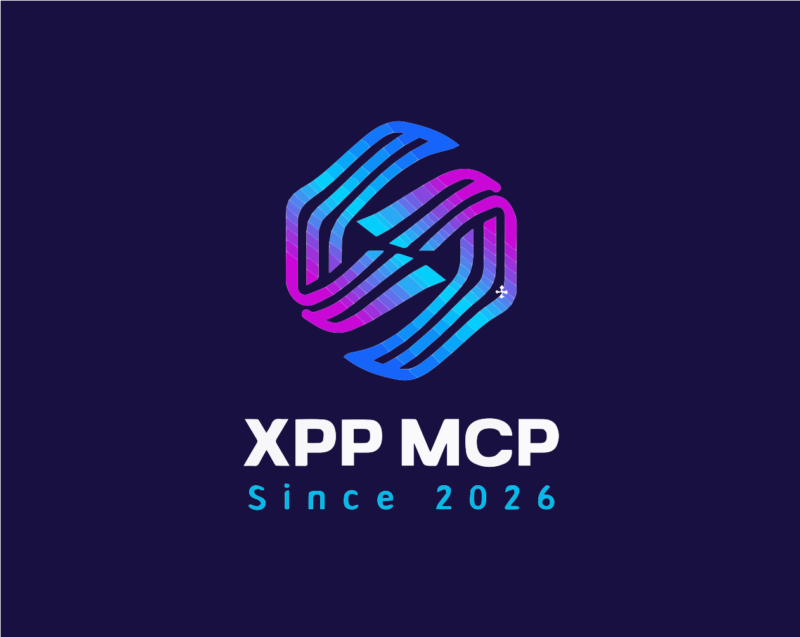

# XPP-MCP

<p align="center">
  
</p>

An MCP (Model Context Protocol) server for Microsoft Dynamics 365 Finance & Operations X++ development.

**Pure TypeScript. No C# sidecar. No VS2022 required for object creation.**

*Đọc bằng tiếng Việt: [README.vi.md](README.vi.md)*

---

## What It Does

XPP-MCP connects Claude Desktop directly to your D365 F&O development environment,
letting you create, inspect, and manage AOT objects through natural language — without
opening Visual Studio.

It reads descriptor XMLs directly from `PackagesLocalDirectory`, writes AOT XML atomically
to the correct path, and wraps the D365 command-line build tools for headless compile and sync.

---

## Features

- **16 object types in one call** — AxTable, AxClass, AxEnum, AxEdt, AxQuery, AxForm,
  AxSecurityPrivilege/Duty/Role, AxMenuItemDisplay/Action/Output, AxMenu, AxMenuExtension, AxTableExtension
- **35 form patterns** — Dialog, SimpleList, SimpleListDetails, DetailsMaster, and more,
  with correct PatternVersion defaults confirmed from 5,682 real Foundation forms
- **Correct form control types** — pass `fieldTypes` map to emit `AxFormDateControl`,
  `AxFormIntegerControl`, `AxFormComboBoxControl` (enum) etc. — not just `AxFormStringControl`
- **VS2022 independent for object creation** — writes AOT XML directly; VS2022 not needed to create objects
- **Headless compile + validate** — wraps `xppc.exe` (compile) and `DataContractSerializer` (XML validation); DB sync requires VS2022
- **Build logs in subfolder** — logs written to `<Model>\xpp-mcp-logs\` to keep the model root clean
- **Label auto-management** — auto-creates `AxLabelFile` descriptor + `.label.txt` when you pass plain text
- **Model-aware path resolution** — reads every descriptor XML at startup; handles multi-model
  packages (e.g. ApplicationSuite → Foundation) correctly
- **Microsoft best practices built-in** — naming conventions, required field groups, security
  chain enforcement, form pattern validation

## 3 Tools

| Tool | What it does |
|---|---|
| `d365_object` | `create`, `inspect`, `delete`, `list_types` — for all 16 AOT object types |
| `d365_build` | `compile`, `validate_metadata`, `best_practice`, `full_build` — headless; `sync_db` directs to VS2022 |
| `d365_explore` | `list_models`, `list_objects`, `search`, `read`, `list_types` |

---

## Quick Start

### 1. Build

```powershell
cd C:\xpp-mcp
npm install
npm run build
```

### 2. Configure `config.json`

```json
{
  "packagesRoot": "C:\\AOSService\\PackagesLocalDirectory",
  "defaultModel": "MM",
  "binPath":      "C:\\AOSService\\PackagesLocalDirectory\\bin",
  "defaultLocale": "en-US",
  "useLabels":    true
}
```

### 3. Start the Server

**Option A — Claude Desktop manages it automatically (recommended)**

Add to `%APPDATA%\Claude\claude_desktop_config.json` and restart Claude Desktop:
```json
{
  "mcpServers": {
    "xpp-mcp": {
      "command": "node",
      "args": ["C:/xpp-mcp/build/index.js"],
      "cwd": "C:/xpp-mcp"
    }
  }
}
```

**Option B — Manual / foreground**

```powershell
cd C:\xpp-mcp
powershell -ExecutionPolicy Bypass -File Start-MD365XppMcp.ps1
```

Or double-click `start.bat`.

**Option C — Auto-start at Windows login (run once as Administrator)**

```powershell
cd C:\xpp-mcp
powershell -ExecutionPolicy Bypass -File Start-MD365XppMcp.ps1 -AsService
```

Expected output on startup:
```
[xpp-mcp] Loaded 176 models (3 custom: BB, CC, MM)
[xpp-mcp] Server ready
```

---

## Starting & Managing the Server

### Start scripts

| File | Purpose |
|---|---|
| `Start-MD365XppMcp.ps1` | Main PowerShell script — foreground run, scheduled task install/remove |
| `start.bat` | Simple double-click launcher |
| `Start-MD365XppMcp-Worker.ps1` | Auto-generated by `-AsService` flag; not in repo |

### Foreground (manual)

```powershell
# From the project folder
powershell -ExecutionPolicy Bypass -File C:\xpp-mcp\Start-MD365XppMcp.ps1
```

Press **Ctrl+C** to stop.

### Auto-start at login (scheduled task)

Install — run **once as Administrator**:
```powershell
cd C:\xpp-mcp
powershell -ExecutionPolicy Bypass -File Start-MD365XppMcp.ps1 -AsService
```

The task starts immediately and restarts automatically if it stops (1-minute retry, up to 99 times).

### Task management commands

```powershell
# Check status
Get-ScheduledTask -TaskName XPP-MCP | Select-Object TaskName, State

# Stop
Stop-ScheduledTask  -TaskName XPP-MCP

# Start
Start-ScheduledTask -TaskName XPP-MCP

# Remove auto-start permanently
powershell -ExecutionPolicy Bypass -File C:\xpp-mcp\Start-MD365XppMcp.ps1 -Remove
```

### View logs

```powershell
Get-Content C:\xpp-mcp\logs\xpp-mcp.log -Tail 30 -Wait
```

The `-Wait` flag tails the log live (like `tail -f`). Press Ctrl+C to stop watching.

---

## Requirements

- Node.js 20+
- Windows (D365 F&O dev VM)
- `PackagesLocalDirectory` accessible (typically `C:\AOSService\PackagesLocalDirectory`)

---

## Documentation

- `docs/ARCHITECTURE.md` — design, components, tool API
- `docs/CLAUDE-DESKTOP-CONFIG.md` — Claude Desktop setup and full usage examples
- `docs/VSCODE-CONFIG.md` — VS Code + Claude Code extension setup
- `docs/SKILL-xpp-mcp.md` — Claude skill file (import into your Claude account)

## Utility Scripts

| Script | Purpose |
|---|---|
| `scripts/ByteFix-AllXml.ps1` | Byte-level repair of `<Name>` tag encoding errors |
| `scripts/Validate-Metadata.ps1` | D365 DataContractSerializer XML validation |
| `scripts/Fix-HtmlEntities.ps1` | Fix HTML entities (`&lt;` `&gt;`) inside CDATA blocks |
| `scripts/Scan-Cdata.ps1` | Diagnose broken CDATA content before fixing |

All scripts accept `-ModelPath "C:\AOSService\PackagesLocalDirectory\<Model>\<Model>"`.

## VS Code / Other MCP Clients

This server uses the standard MCP stdio transport and works with any MCP-compatible client.

- **VS Code + Claude Code extension** — see [`docs/VSCODE-CONFIG.md`](docs/VSCODE-CONFIG.md) for full setup
- **Claude Code CLI** — same `~/.claude/settings.json` config as VS Code
- **Other MCP clients** — use the same `command`/`args`/`cwd` block their config expects

---

## Disclaimer

**This tool is intended for use on local development machines, personal VHD/VMs, or environments where you have explicit authorization from the system and data owner.**

Do not use this tool on production systems, shared environments, or customer environments without explicit written approval from the appropriate stakeholders.

**Microsoft Dynamics 365 license requirement**

This tool requires a valid **Microsoft Dynamics 365 Finance & Operations developer license**. It depends on and invokes Microsoft-owned binaries that are part of the licensed D365 F&O development environment:

- `xppc.exe` — X++ compiler
- `xppbp.exe` — Best practice checker
- `SyncEngine.exe` — Database sync engine

These binaries are proprietary software owned by Microsoft Corporation and are subject to Microsoft's software license terms. This tool does not distribute, modify, or circumvent any Microsoft software. Users are solely responsible for ensuring they hold the appropriate Microsoft licenses before using this tool.

**What this tool does to your system:**
- Writes AOT XML files directly to `PackagesLocalDirectory` (bypasses VS2022 project system)
- Executes `xppc.exe` and `xppbp.exe` from the D365 bin directory
- Creates and modifies label files (`.label.txt`) in your model folder

Incorrect use can corrupt AOT metadata, break model builds, or cause unrecoverable changes to your D365 development environment. **Always ensure your work is committed to source control (Azure DevOps / Git) before using this tool.**

This project is independent and is not affiliated with, endorsed by, or supported by Microsoft Corporation. "Dynamics 365", "Finance & Operations", "X++", and all related product names are trademarks of Microsoft Corporation.

The tooling and documentation provided here are for development assistance purposes only. No guarantees are made regarding accuracy, completeness, or fitness for any particular purpose. The authors accept no responsibility for any errors, omissions, metadata corruption, data loss, or other damages — direct or indirect — that may result from use of this tool.

**Use at your own risk.**

---

## License

**Free for individuals. Commercial license required for businesses.**

| Who | Terms |
|---|---|
| Individual developers, personal projects | **Free** |
| Students, educators, non-profits | **Free** |
| Open source contributors | **Free** — contributions welcome |
| Businesses, consulting firms, enterprise use | **Commercial license required** — [open an issue](https://github.com/minhd365/xpp-mcp/issues) |

On **2029-01-01** this software automatically converts to the **MIT License** (fully open source).

See [`LICENSE`](LICENSE) for full terms.
