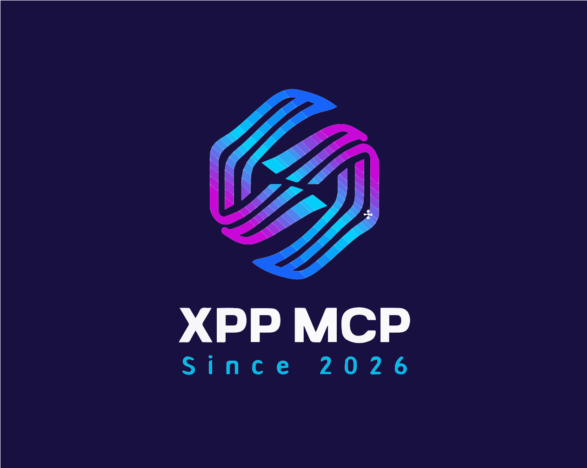

# XPP-MCP

<p align="center">
  
</p>

Máy chủ MCP (Model Context Protocol) dành cho phát triển X++ trên Microsoft Dynamics 365 Finance & Operations.

**Thuần TypeScript. Không cần C# sidecar. Không cần VS2022 để tạo đối tượng.**

---

## Chức năng

XPP-MCP kết nối Claude Desktop trực tiếp với môi trường phát triển D365 F&O,
cho phép bạn tạo, kiểm tra và quản lý các đối tượng AOT bằng ngôn ngữ tự nhiên — mà
không cần mở Visual Studio.

Công cụ đọc descriptor XML trực tiếp từ `PackagesLocalDirectory`, ghi AOT XML theo cơ chế
atomic đến đúng đường dẫn, và bọc các công cụ build D365 để biên dịch và đồng bộ headless.

---

## Tính năng

- **16 loại đối tượng AOT trong một lệnh** — AxTable, AxClass, AxEnum, AxEdt, AxQuery, AxForm,
  AxSecurityPrivilege/Duty/Role, AxMenuItemDisplay/Action/Output, AxMenu, AxMenuExtension, AxTableExtension
- **35 form pattern** — Dialog, SimpleList, SimpleListDetails, DetailsMaster và nhiều hơn,
  với PatternVersion mặc định chính xác được xác nhận từ 5.682 form Foundation thực tế
- **Kiểu control form chính xác** — truyền `fieldTypes` để tạo `AxFormDateControl`,
  `AxFormIntegerControl`, `AxFormComboBoxControl` (enum) v.v. — không chỉ `AxFormStringControl`
- **Độc lập VS2022** — CRUD đối tượng hoạt động bằng cách ghi AOT XML trực tiếp; VS2022 chỉ cần cho MSBuild
- **Build/sync headless** — bọc trực tiếp `xppc.exe` và `SyncEngine.exe`
- **Log build vào thư mục riêng** — log được ghi vào `<Model>\xpp-mcp-logs\` để giữ thư mục model sạch sẽ
- **Quản lý nhãn tự động** — tự động tạo `AxLabelFile` descriptor + `.label.txt` khi truyền văn bản thuần
- **Phân giải đường dẫn theo model** — đọc tất cả descriptor XML khi khởi động; xử lý đúng các package đa-model
- **Tuân thủ best practice Microsoft** — quy ước đặt tên, field group bắt buộc, chuỗi bảo mật, xác thực form pattern

## 3 Công cụ

| Công cụ | Chức năng |
|---|---|
| `d365_object` | `create`, `inspect`, `delete`, `list_types` — cho tất cả 16 loại đối tượng AOT |
| `d365_build` | `compile`, `sync_db`, `best_practice`, `full_build`, `validate_metadata` — headless, không cần VS2022 |
| `d365_explore` | `list_models`, `list_objects`, `search`, `read`, `list_types` |

---

## Bắt đầu nhanh

### 1. Build

```powershell
cd <thư_mục_dự_án>
npm install
npm run build
```

### 2. Cấu hình `config.json`

Sao chép `config.example.json` thành `config.json` và chỉnh sửa theo môi trường của bạn:

```json
{
  "packagesRoot": "C:\\AOSService\\PackagesLocalDirectory",
  "defaultModel": "AA",
  "binPath":      "C:\\AOSService\\PackagesLocalDirectory\\bin",
  "defaultLocale": "en-US",
  "useLabels":    true
}
```

### 3. Khởi động máy chủ

**Phương án A — Claude Desktop quản lý tự động (khuyến nghị)**

Thêm vào `%APPDATA%\Claude\claude_desktop_config.json` và khởi động lại Claude Desktop:
```json
{
  "mcpServers": {
    "xpp-mcp": {
      "command": "node",
      "args": ["C:/xpp-mcp/build/index.js"],
      "cwd": "C:/xpp-mcp"
    }
  }
}
```

**Phương án B — Thủ công / foreground**

```powershell
powershell -ExecutionPolicy Bypass -File Start-MD365XppMcp.ps1
```

Hoặc nhấp đúp `start.bat`.

**Phương án C — Tự khởi động khi đăng nhập Windows (chạy một lần với quyền Administrator)**

```powershell
powershell -ExecutionPolicy Bypass -File Start-MD365XppMcp.ps1 -AsService
```

Kết quả hiển thị khi khởi động thành công:
```
[xpp-mcp] Loaded 176 models (1 custom: AA)
[xpp-mcp] Server ready
```

---

## Khởi động và quản lý máy chủ

### Script khởi động

| Tệp | Mục đích |
|---|---|
| `Start-MD365XppMcp.ps1` | Script PowerShell chính — foreground, cài đặt/gỡ scheduled task |
| `start.bat` | Launcher nhấp đúp đơn giản |
| `Start-MD365XppMcp-Worker.ps1` | Script worker tự tạo, dùng bởi scheduled task |

### Foreground (thủ công)

```powershell
powershell -ExecutionPolicy Bypass -File Start-MD365XppMcp.ps1
```

Nhấn **Ctrl+C** để dừng.

### Tự khởi động khi đăng nhập Windows

Cài đặt — chạy **một lần với quyền Administrator**:

```powershell
powershell -ExecutionPolicy Bypass -File Start-MD365XppMcp.ps1 -AsService
```

### Lệnh quản lý task

```powershell
# Kiểm tra trạng thái
Get-ScheduledTask -TaskName XPP-MCP | Select-Object TaskName, State

# Dừng / Khởi động / Gỡ bỏ
Stop-ScheduledTask  -TaskName XPP-MCP
Start-ScheduledTask -TaskName XPP-MCP
powershell -ExecutionPolicy Bypass -File Start-MD365XppMcp.ps1 -Remove
```

### Xem log

```powershell
Get-Content logs\xpp-mcp.log -Tail 30 -Wait
```

---

## Yêu cầu hệ thống

- Node.js 20+
- Windows (D365 F&O dev VM)
- `PackagesLocalDirectory` có thể truy cập (thường tại `C:\AOSService\PackagesLocalDirectory`)

---

## Tài liệu

| Tệp | Nội dung |
|---|---|
| `docs/ARCHITECTURE.md` | Thiết kế, các thành phần, Tool API |
| `docs/CLAUDE-DESKTOP-CONFIG.md` | Cài đặt Claude Desktop và ví dụ đầy đủ |
| `docs/SKILL-xpp-mcp.md` | File skill cho Claude |

---

## Lưu ý quan trọng

**Khởi động lại Claude Desktop sau khi recompile** — máy chủ MCP nạp code vào bộ nhớ
khi khởi động; thay đổi trong `build/` chỉ có hiệu lực sau khi restart.

**Log build** được ghi vào `<Model>\xpp-mcp-logs\` — thư mục con tự tạo, giữ root sạch.

**sync_db cần VS2022** — sau khi biên dịch, đồng bộ DB trong VS2022:
`Dynamics 365 → Synchronize database`

---

## Tuyên bố miễn trách nhiệm

**Công cụ này chỉ dành cho sử dụng trên máy phát triển cục bộ, VHD/VM cá nhân, hoặc các môi trường mà bạn được phép sử dụng một cách rõ ràng từ chủ sở hữu hệ thống.**

Không sử dụng công cụ này trên hệ thống production, môi trường dùng chung, hoặc môi trường khách hàng mà không có sự chấp thuận rõ ràng bằng văn bản từ các bên liên quan.

**Yêu cầu giấy phép Microsoft Dynamics 365**

Công cụ này yêu cầu **giấy phép nhà phát triển Microsoft Dynamics 365 Finance & Operations** hợp lệ. Nó phụ thuộc vào và gọi các tệp nhị phân thuộc sở hữu của Microsoft, là một phần của môi trường phát triển D365 F&O được cấp phép:

- `xppc.exe` — Trình biên dịch X++
- `xppbp.exe` — Công cụ kiểm tra best practice
- `SyncEngine.exe` — Công cụ đồng bộ cơ sở dữ liệu

Các tệp nhị phân này là phần mềm độc quyền thuộc sở hữu của Microsoft Corporation và chịu sự điều chỉnh của điều khoản giấy phép phần mềm của Microsoft. Công cụ này không phân phối, chỉnh sửa hoặc phá vỡ bất kỳ phần mềm nào của Microsoft. Người dùng hoàn toàn chịu trách nhiệm đảm bảo họ có đủ giấy phép Microsoft phù hợp trước khi sử dụng công cụ này.

**Những gì công cụ này thực hiện trên hệ thống của bạn:**
- Ghi trực tiếp các tệp AOT XML vào `PackagesLocalDirectory` (bỏ qua hệ thống project của VS2022)
- Thực thi `xppc.exe` và `xppbp.exe` từ thư mục bin của D365
- Tạo và chỉnh sửa các tệp nhãn (`.label.txt`) trong thư mục model của bạn

Sử dụng không đúng cách có thể làm hỏng AOT metadata, gây lỗi build model, hoặc tạo ra các thay đổi không thể phục hồi. **Hãy đảm bảo công việc của bạn đã được commit lên source control (Azure DevOps / Git) trước khi sử dụng công cụ này.**

Dự án này là độc lập và không liên kết, được xác nhận hoặc hỗ trợ bởi Microsoft Corporation. "Dynamics 365", "Finance & Operations" và tất cả các tên sản phẩm liên quan là thương hiệu của Microsoft Corporation.

Công cụ và tài liệu được cung cấp ở đây chỉ nhằm mục đích hỗ trợ phát triển. Không có bảo đảm nào về tính chính xác, đầy đủ hoặc phù hợp cho bất kỳ mục đích cụ thể nào. Tác giả không chịu trách nhiệm về bất kỳ lỗi, thiếu sót, hỏng metadata, mất dữ liệu hoặc thiệt hại nào — trực tiếp hay gián tiếp — có thể xảy ra khi sử dụng công cụ này.

**Sử dụng theo trách nhiệm của bạn.**

---

## Giấy phép

**Miễn phí cho cá nhân. Doanh nghiệp cần liên hệ để được cấp phép thương mại.**

| Đối tượng | Điều khoản |
|---|---|
| Lập trình viên cá nhân, dự án cá nhân | **Miễn phí** |
| Học sinh, giáo viên, tổ chức phi lợi nhuận | **Miễn phí** |
| Đóng góp mã nguồn mở | **Miễn phí** — hoan nghênh đóng góp |
| Doanh nghiệp, công ty tư vấn, sử dụng trong doanh nghiệp | **Cần giấy phép thương mại** — [mở issue tại đây](https://github.com/minhd365/xpp-mcp/issues) |

Vào ngày **2029-01-01**, phần mềm này tự động chuyển sang **Giấy phép MIT** (mã nguồn mở hoàn toàn).

Xem tệp [`LICENSE`](LICENSE) để biết chi tiết đầy đủ.

---

*Tệp README tiếng Anh: [README.md](README.md)*
